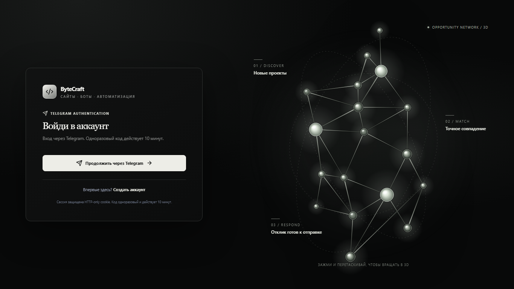
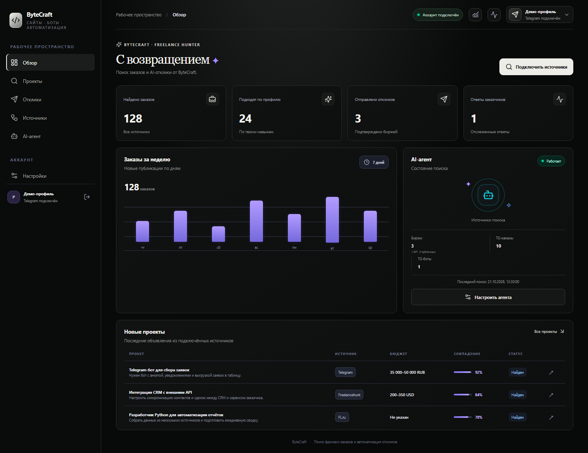

# Case study: ByteCraft Freelance Hunter

## Summary

ByteCraft Freelance Hunter collects public freelance opportunities, ranks them against a user profile, and prepares proposal drafts through a web workspace and Telegram companion.

## Problem

Freelance requests are scattered across channels and platforms. Manually reviewing each post, checking whether it fits a developer's skills and minimum budget, and drafting a response takes time. A collector also needs to distinguish a draft from a proposal that was actually submitted.

## Implemented in the repository

- Telegram-only sign-in with a short-lived one-time code and HTTP-only session cookie.
- User-scoped workspace data for projects, source subscriptions, profiles, agent settings, integrations, and applications.
- Public Telegram preview ingestion with normalized listing records, duplicate prevention, source health fields, and a scheduled scan trigger.
- A curated list of ten public Telegram channels for developer work, no-code, IT freelance, and broader freelance listings. The production scan verified @FreelancehuntProjects; each other channel still needs its own scan evidence.
- Explainable matching scores with language, budget, excluded-keyword, unpaid-work, risk, and complexity signals.
- RU/EN proposal drafting through an OpenAI-compatible endpoint. Prompts treat listing text as untrusted and instruct the model not to invent experience or credentials.
- Editable proposal drafts and an optional automatic-submission mode for eligible Freelancehunt listings. The application is never marked as sent without a verified provider result. Other sources remain draft-only.
- A separate automatic reply setting for new employer messages in matched Freelancehunt threads. It requires a confirmed bid, unique project-title match, valid AI output, and respects the daily send cap; live reply delivery awaits a suitable real thread.
- Telegram account linking, statistics, recent project summaries, and pause/resume commands. Project counts and links are available through bot commands; separate messages for each new listing are disabled.
- Automated CI for backend tests and migrations, frontend lint/build and Playwright smoke tests, Cloudflare Worker typecheck/tests, plus CodeQL and Dependabot configuration.

## Architecture

- **Web:** Next.js, TypeScript, React.
- **API and ingestion:** Cloudflare Worker, TypeScript, D1, scheduled Cron Trigger.
- **Telegram companion:** Python/aiogram codebase and Worker webhook integration.
- **Local/backend track:** FastAPI, SQLAlchemy/Alembic, PostgreSQL for local and separately hosted deployments.

## Production verification snapshot (21 October 2026)

- The API Worker health endpoint returns HTTP 200 with D1 connected and schema ready. The production website and authenticated dashboard also return and render successfully.
- The dashboard aggregates source and application data. Its live snapshot reports zero provider-confirmed submissions and zero tracked replies; the agent's saved settings render after loading. Acceptance did not alter those settings, start a scan, or submit any application.
- Scheduled scans previously verified public Telegram, FL.ru, and Freelance.ru sources. The current integration surface offers one official marketplace API (Freelancehunt) and two public-search sources. FL.ru and Freelance.ru are discovery-only.
- After PR #95, the AI-agent page has a separate Freelancehunt reply control. Production migration 0013 and both Worker deployments were verified. The active account's new setting is on, but there are zero eligible sent bids and zero tracked threads, so real message delivery has not been tested.
- Production AI generation was verified on Russian and English listings. The saved drafts used the listing language and profile-grounded information; no proposal was sent.
- PR #89 fixed the agent settings first-paint and a Freelance.ru Moscow-midnight publication-time parser defect. CI/CodeQL passed before merge; API and web production health were checked after deployment.

## Constraints and remaining acceptance work

- Telegram-only sign-in is the accepted identity flow. Email/password registration and recovery were explicitly removed from product scope.
- A real Telegram `/stats` command and notification delivery have not been verified because the user explicitly chose to leave that test open. No OTP or QR login was attempted.
- Live two-account data isolation and session-expiry behavior have not been exercised with two real production accounts. Automated tests cover owner-scoped endpoints and expired-session rejection.
- Russian and English generation have each been demonstrated on a skills-aligned production listing. This focused smoke test is not an exhaustive quality assessment; generated drafts should still be reviewed before sending.
- Automated bid submission is available only through Freelancehunt's verified API; FL.ru and Freelance.ru are discovery-only and require manual submission. A real employer-facing bid was not sent as an acceptance test.
- Cloudflare D1 Time Travel is available for production recovery. A production restore has not been attempted because it overwrites live data; the synthetic local D1 export/import drill passed.
- User-specific project counts are a snapshot, not a throughput or success-rate claim. No production latency, cost, or conversion metrics are claimed.
- Production sign-in and synthetic authenticated-workspace screenshots are included below. The workspace image uses mocked demonstration data and is not evidence of production counts. A Telegram bot screenshot and demo recording remain outstanding for a complete visual portfolio case.

## Production sign-in screenshot

## Verification

CI is the source of truth for repository checks. Live deployment verification is separate and must include the smoke-test checklist in [Operations and recovery](OPERATIONS.md). Update this case study only when a feature has been tested and confirmed; do not turn planned integrations into completed achievements.

## Synthetic authenticated workspace screenshot

This dashboard image was captured from the built application with locally mocked demonstration data. It contains no production account data and does not verify those displayed counts.

